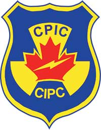

The Canadian Police Information Centre (CPIC) provides information on stolen property. It's the only national information-sharing system that links criminal justice and law enforcement partners across Canada and internationally. CPIC offers a public search tool to provide updates on property or motor vehicles reported stolen. Search for the following items using the relevant identification number.

					

	

<section class="gc-srvinfo">
<h2>Public searches</h2>

<h3><a href="sve-rve-en.html">Vehicles</a></h3>

Look up autos, trucks, vans and other vehicles by vehicle identification number (VIN).
   

<h3><a href="sbi-rve-en.html">Bicycles</a></h3>

Search by serial number. 
   

<h3><a href="spt-rpt-en.html">Property</a></h3>

Search for electronic devices or other items by serial number.
   

<h3><a href="sbo-rba-en.html">Boats</a></h3>

Search by name, hull identification, licence, or registration number.
   

<h3><a href="sfa-raf-en.html">Firearms</a></h3>

Search by serial number. 
   

<h3><a href="sbm-rmb-en.html">Boat motors</a></h3>

Search by type and serial number.
   

</section>
<section class="gc-srvinfo gc-more">
<h2>Learn more</h2>
<h3><a href="faq-en.html">Frequently Asked Questions</a></h3>

Find more information about stolen property and what to do. 
   
</section>
