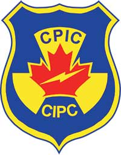

		

The Canadian Police Information Centre (CPIC) provides information on stolen property. It's the only national information-sharing system that links criminal justice and law enforcement partners across Canada and internationally. CPIC offers a public search tool to provide updates on property or motor vehicles reported stolen. Search for items by listed identification numbers.

					

	

<section class="gc-srvinfo">
<h2 class="wb-inv">Public searches</h2>

<h3><a href=" ">Vehicles</a></h3>

Look up autos, trucks, vans and other vehicles by vehicle identification number (VIN).
   

<h3><a href=" ">Bicycles</a></h3>

Search by serial number. 
   

<h3><a href=" ">Property</a></h3>

Search for electronic devices or other items by serial number.
   

<h3><a href=" ">Boats</a></h3>

Search by name, hull identification, licence, or registration number.
   

<h3><a href=" ">Firearms</a></h3>

Search by serial number. 
   

<h3><a href=" ">Boat motors</a></h3>

Search by type and serial number.
   

	
</section>

